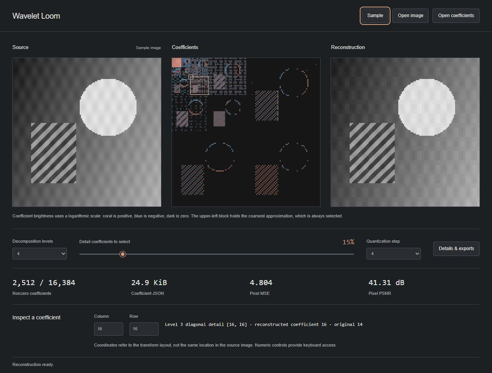

# Wavelet Loom

A local image-processing workbench for two-dimensional Haar transforms, detail selection, quantization, and reconstruction. Compare source pixels, a signed coefficient heatmap, and reconstructed pixels; save a portable sparse coefficient file and restore its image independently.



## Interface

Source, coefficient heatmap, and reconstruction share the main image workspace. The retention slider sits underneath, followed by measured quality and a coordinate inspector. Click the heatmap to select a coefficient; numeric controls remain available for keyboard use. Detailed quality notes and file exports open separately.

The selected coefficient also outlines its Haar subband and identifies its level and direction. The outline moves between bands, while new reconstructions fade in briefly; both effects respect reduced-motion preferences. Overlays are separate from the canvas and never enter PNG exports.

## Run

```sh
python run.py --port 8000
```

Open http://127.0.0.1:8000 in a modern browser with module workers, Canvas, and `createImageBitmap`. Python 3.10+ serves static assets and Node 22+ runs dependency-free tests. Images are processed locally without uploads.

## Explore

The generated 128×128 study combines a smooth gradient, a circle, a striped region, and texture. Its default four-level transform selects 15% of detail positions and quantizes in steps of four. The output contains 2,512 nonzero coefficients, occupies 25,503 compact JSON bytes, and reconstructs with pixel MSE 4.8042603 and PSNR 41.3145 dB.

Move the detail slider to zero to keep only the coarsest approximation block. Increase depth to seven to reduce that block to one coefficient. Quantization independently changes coefficient precision. Numeric row/column controls inspect original and reconstructed coefficients with keyboard access.

Open PNG/JPEG/WebP images up to 8 MiB and 16 million decoded pixels. The browser flattens transparency onto white, fits the image inside a 128×128 white square without cropping, and computes grayscale from encoded RGB channels with weights 0.2126/0.7152/0.0722. Color, linear-light processing, and original resolution are not preserved. Browser image resampling/color handling can affect the imported source; evidence stores the actual grayscale pixels used.

Save coefficients to reconstruct without the source image. On import, source-reference MSE/PSNR become unknown and encoding controls are disabled. **Use reconstruction as source** explicitly starts a new experiment whose reference is the decoded image. PNG downloads contain the reconstructed opaque grayscale bytes.

## Transform and selection

At each level, 2×2 spatial blocks `(p,q;r,s)` map to approximation, horizontal, vertical, and diagonal terms:

```text
(p+q+r+s)/2    (p-q+r-s)/2
(p+q-r-s)/2    (p-q-r+s)/2
```

These are stored in four quadrants of the current square; the next level transforms only its upper-left approximation. Reconstruction traverses levels in reverse with the same orthogonal block matrix. Combining the two separable Haar stages into a factor of 1/2 avoids unnecessary square-root rounding. Byte inputs and the bounded dyadic coefficients remain exactly representable through the unquantized transform.

All coarsest approximation positions are selected. Detail positions are ranked by absolute coefficient magnitude, breaking ties by flattened row-major index. The selected count is `floor(detailCount × keepPercent / 100)`. Selected coefficients are divided by the integer step, rounded with JavaScript `Math.round` (half ties toward positive infinity), and stored only if nonzero. Dequantization multiplies by the step.

Raw reconstruction is rounded and clipped to bytes. MSE/PSNR use those final bytes; exact byte equality is displayed explicitly and represented by `mse: 0, psnr: null`. Raw image squared error and coefficient squared error are also reported; orthonormality makes them agree before byte rounding/clipping. The heatmap uses log magnitude and sign colors, not a calibrated linear intensity scale.

## Portable representation

The exact JSON fields are `format: "wavelet-loom-v1"`, `size`, `levels`, `step`, and `coefficients`. Each coefficient is `[flattenedIndex, quantizedInteger]`, sorted strictly by index. Missing entries are zero. Supported sizes are 32/64/128/256, depths 1–log2(size), and steps 1–128. Duplicate, unsorted, zero-valued, out-of-range, or malformed entries are rejected; import is capped at 2 MB. Coefficient magnitudes are bounded by `ceil(255 × size / step)`.

This is sparse JSON, not entropy coding or a standard wavelet codec. Zeroing coefficients does not by itself prove file compression: the default JSON is larger than the 16,384 raw grayscale bytes. The size metric measures actual compact JSON bytes, excluding pretty-printing and transfer overhead. The format has no encryption, checksum, signature, source provenance authentication, or corruption correction; syntactically valid edits can produce a different image.

Evidence contains the source pixels when available, raw and quantized coefficients, raw inverse values, byte reconstruction, and metrics. Imported coefficient evidence has no missing source silently invented. [Example coefficient file](docs/example-coefficients.json) · [reconstructed PNG](docs/reconstruction.png).

## Verification

```sh
npm test
npm run check
python -m unittest discover -s tests -v
```

Five JavaScript tests cover every supported dimension/depth, inverse and energy identities, direct block-basis checks, constant images, multiple detail/quantization combinations, exact sparse-file decoding, and malformed structures. A Python HTTP test checks static allowlisting, Host validation, and HEAD responses. CI runs Node 22/24 on Linux and Node 24 on Windows.

Browser checks covered zero-detail/deep decomposition, coordinate inspection, coefficient import, unknown reference quality, reconstruction reuse, actual image import, and exports. The restored coefficient file produced a byte-identical PNG. Independent Python block-matrix inversion verified every one of the 16,384 raw inverse values and decoded PNG pixels, plus MSE, PSNR, and coefficient-file contents.

Background: MathWorks' [2-D wavelet compression example](https://www.mathworks.com/help/wavelet/ug/data-compression-using-2d-wavelet-analysis.html) describes decomposition, coefficient reduction, and reconstruction. This standalone implementation uses its own explicitly specified Haar layout and sparse JSON format.
